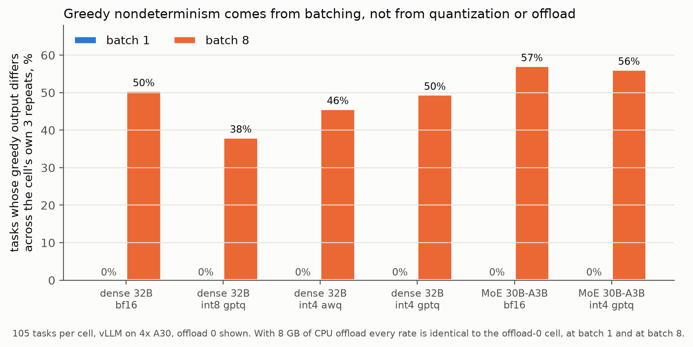

# QuantForensics

**Batching, Not Quantization, Drives Greedy Nondeterminism: A Pre-Registered
Study of Published Quantizations on NVIDIA A30 GPUs**

I set out to find where greedy decoding from quantized models stops being
repeatable, and whether quantization itself is to blame. I ran a controlled,
pre-registered factorial over weight format, batch size and CPU offload, then
extended the clean condition across three model sizes.

- Every cell at batch 1 was perfectly deterministic, whatever the weight
  format or offload. Every cell at batch 8 flipped 38--57% of tasks across its
  own repeats, the bf16 references included. Batching is the cause.
- Quantization moved many tokens but few outcomes. The one degraded stratum
  is 7B GPTQ-Int4 math, 17 to 7 of 40 tasks (McNemar p = 0.013).
- One registered prediction was refuted, and I report it as refuted. A
  post-hoc check shows the refutation came from a flaw in my own
  pre-registration (mismatched near-tie thresholds across model sizes). The
  paper says so plainly and keeps the registered and post-hoc results apart.

## What is here

- `paper/quantforensics.pdf` -- the paper, with figures inline
- `paper/quantforensics.md` -- the same paper as Markdown
- `PROTOCOL.md` -- the measurement laws and every dated amendment, each
  written before the results it governs
- `analyses/registered/` -- the per-cell analyses behind every reported
  number, scored under the registered thresholds
- `analyses/post-hoc-sensitivity/` -- the unregistered common-threshold
  rescoring, marked PROVISIONAL by the instrument that produced it
- `figures/` -- every chart in the paper, generated from these analyses
