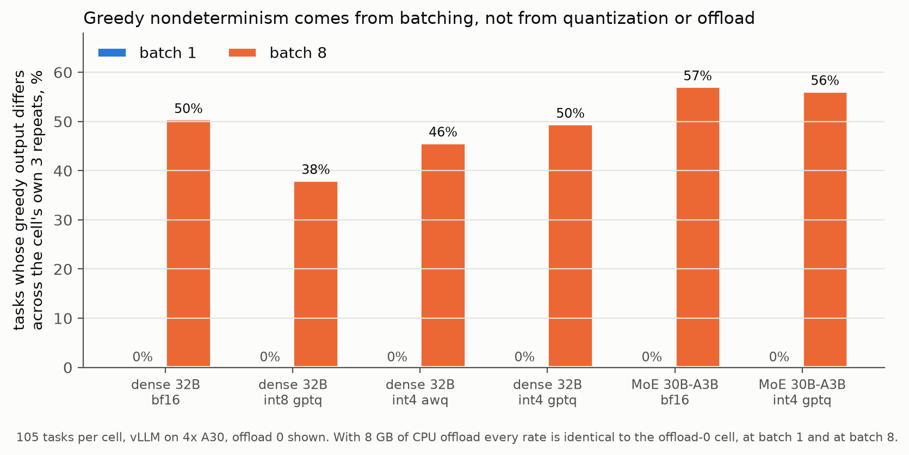
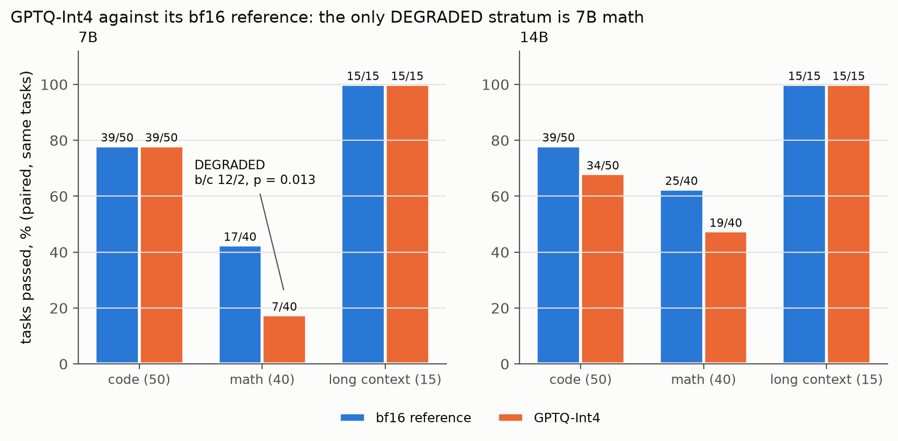
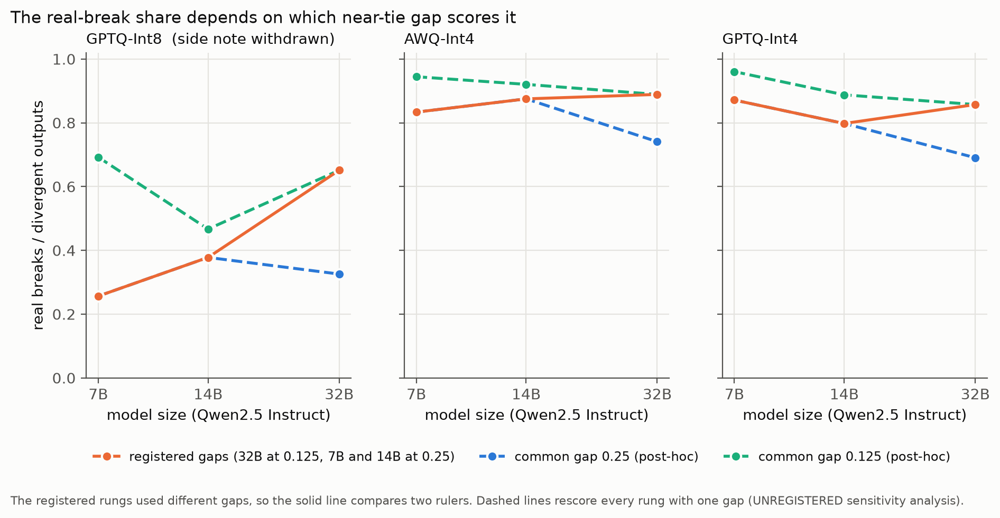

# Batching, Not Quantization, Drives Greedy Nondeterminism: A Pre-Registered Study of Published Quantizations on NVIDIA A30 GPUs

## Abstract

Greedy decoding from quantized large language models is often assumed to be deterministic, yet practitioners observe run-to-run variation. I isolated the source of this variation by running a controlled factorial over a frozen 105-task suite (50 code, 40 math, 15 needle retrieval) on NVIDIA A30 GPUs using vLLM 0.29.0. I crossed weight format (bf16, GPTQ-Int8, AWQ-Int4, GPTQ-Int4), batch size (1, 8), and CPU offload (on, off) for Qwen2.5-32B-Instruct and Qwen3-30B-A3B. I ran three exact greedy repeats per cell. Every cell at batch 1 was perfectly deterministic regardless of weight format or offload. Every cell at batch 8 flipped 38--57% of tasks across its own repeats, including the bf16 references. Offload was bit-identical to its non-offload counterpart. I registered predictions before any run. In a second phase I extended the confound-free cells (batch 1, offload off) to 7B and 14B. Quantization moved many tokens but few outcomes. Int4 diverged from bf16 on 77--80% of outputs, yet pass/fail changed on only 9--12 tasks per cell, and no stratum degraded at any size except one. The single degraded stratum was 7B GPTQ-Int4 math, which dropped from 17 to 7 of 40 tasks (McNemar p = 0.013). I registered a prediction that the int4 real-break fraction would rise monotonically as models shrank. It was refuted. The refutation was driven by mismatched classification thresholds across the rungs, not by the data going against the predicted direction.

## 1. Introduction

When a quantized language model produces a different greedy output on a second run with the same prompt, is the quantization at fault? This question matters for reproducibility audits, evaluation pipelines, and deployment decisions. Published quantizations of the same checkpoint are routinely treated as faithful stand-ins for the original weights. Still, the interaction between quantized kernels, batched inference, and hardware numerics has not been separated in a controlled way.

I built a pre-registered experimental protocol to separate these factors. In the protocol I defined nine laws that govern how each cell is run, how the bf16 reference is measured, and how divergences are classified. Every quantized cell uses a quantization of the exact reference checkpoint. A quantization built from a different revision is a different experiment (law 1). The reference noise is the floor, so a quantized cell degrades a stratum only when its drop exceeds the reference's own A/A' spread on that stratum (law 2). I make no claim that quantization causes nondeterminism until the confound factorial shows the effect survives with offload off and batch 1 (law 3).

I report findings from two phases. In the first (P1) I ran a batch x offload x weight-format factorial at 32B (dense) and 30B-A3B (MoE) to isolate the source of greedy nondeterminism. In the second (P2) I extended the confound-free condition (batch 1, offload off) to 7B and 14B to test whether quantization damage grows as the model shrinks.

## 2. Method

### 2.1 Task Suite

I employed a frozen 105-task suite of 50 code tasks, 40 math tasks, and 15 needle-retrieval tasks, and held the suite constant across every cell and every phase.

### 2.2 Models and Quantizations

I tested Qwen2.5-Instruct dense at 7B, 14B, and 32B parameters, and Qwen3-30B-A3B, which is a mixture-of-experts architecture with 30B total and 3B active parameters. I ran the MoE with thinking mode disabled. Per size I employed the published quantizations released for the same checkpoints. These are GPTQ-Int8, AWQ-Int4, and GPTQ-Int4 for the dense models, and GPTQ-Int4 for the MoE. I declare the provenance of these quantizations, but I did not independently verify it (law 1).

### 2.3 Inference Setup

I ran all cells on four NVIDIA A30 GPUs under vLLM 0.29.0 with bf16 activations, eager execution, one attention backend, and a context length of 16384 tokens, and used greedy decoding with neutral penalties and raw logprobs throughout. Each cell received three exact repeats, and I gave each repeat its own seeded shuffle of the 105 tasks.

### 2.4 Factorial Design

In P1 I crossed weight format with batch size (1, 8) and CPU offload (on, off). The weight formats were bf16, GPTQ-Int8, AWQ-Int4, and GPTQ-Int4 for dense 32B, and bf16 and GPTQ-Int4 for MoE 30B-A3B. In P2 I held batch size at 1 and offload off, and crossed weight format with model size (7B, 14B, 32B). The 7B rung ran at tensor-parallel width 1 (TP1), the 14B rung at TP2, and the 32B rung at TP4.

### 2.5 Divergence Classifier

For every output that differed from the bf16 reference, I recorded the first token at which they diverged and the reference model's top-1/top-2 logprob gap at that position. If that gap fell below a registered threshold (the near-tie gap), I classified the divergence as a near-tie flip. In that case the reference was already close to choosing the quantized model's token, and the quantized model tipped the balance. If the gap met or exceeded the threshold, I classified it as a real break, where the quantized model overrode a decision the reference was more certain about.

### 2.6 Outcome Testing

I labelled a stratum (code, math, or long context) DEGRADED only when discordant tasks favored the reference with McNemar p < 0.05. I compared pass/fail outcomes per task between each quantized cell and its same-size bf16 reference, using the exact two-sided McNemar test at alpha = 0.05, and reported differences inside the floor as "no detectable change", never as "lossless" (law 2).

## 3. Protocol

### 3.1 Laws

I registered nine laws before any run. The five most consequential follow. (1) Same weights. Every quantized cell is a quantization of the exact reference checkpoint. (2) Reference noise is the floor. Differences inside the reference's own A/A' spread are "no detectable change". (3) Separate the confound first. I make no claim about quantization until batching and offload are ruled out. (4) Determinism is measured, not assumed. Every cell gets exact greedy repeats. (5) Classify every divergence. Each differing output gets a first-divergence token and the reference's top-1/top-2 gap there. Below the registered near-tie gap it is a near-tie flip. At or above it the divergence is a real break. Unclassified divergences block the verdict.

### 3.2 Reference Floors

I measured each bf16 reference by its own A/A' test (2 loads on different nodes, 3 exact repeats each, all 105 tasks) before analyzing any cell that used that reference. The 32B dense reference showed 0 flips and per-stratum pass spread of 0.000. Because the spread was exactly 0, a stratum degrades only when discordant tasks favor the reference (b > c) with exact two-sided McNemar p < 0.05 (amendment A1). I registered the near-tie gap for the 32B reference at 0.125 nats. The MoE reference showed the same zero floor (amendment A2), with a near-tie gap of 0.25 nats. Both the 7B and 14B dense references showed 0 flips and spread 0.000 (amendments A4 and A5). I registered each floor before any cell of that size ran, with near-tie gap 0.25.

### 3.3 Registered Predictions

Before any P2 run I registered three predictions (amendment A3). P2.1 held that int8 shows no detectable change on any stratum at either size. P2.2 held that the int4 real-break fraction rises monotonically as the model shrinks (7B > 14B > 32B). P2.3 held that math is the first stratum to reach DEGRADED, if any does. I committed in advance to report a non-monotone finding on P2.2 as a refutation, not to explain it away.

## 4. Results

### 4.1 Batching Causes the Nondeterminism

*Figure 1. Greedy nondeterminism by batch size and weight format. Flip rate is the share of the 105 tasks whose greedy tokens differ across the cell's own 3 repeats. Every cell at batch 1 is perfectly deterministic (flip rate 0.000). Every cell at batch 8 flips 38--57% of tasks, including the bf16 references. Offload is bit-identical to its non-offload counterpart at both batch sizes.*

The P1 factorial separated batching, offload, and weight format. The findings are given by the table below, and they are clear.

| model | weights | flip rate b1 (off0 / off8) | flip rate b8 (off0 / off8) |
|---|---|---|---|
| dense 32B | bf16 | 0.000 / 0.000 | 0.505 / 0.505 |
| dense 32B | int8 GPTQ | 0.000 / 0.000 | 0.381 / 0.381 |
| dense 32B | int4 AWQ | 0.000 / 0.000 | 0.457 / 0.457 |
| dense 32B | int4 GPTQ | 0.000 / 0.000 | 0.495 / 0.495 |
| MoE 30B-A3B | bf16 | 0.000 / 0.000 | 0.571 / 0.571 |
| MoE 30B-A3B | int4 GPTQ | 0.000 / 0.000 | 0.562 / 0.562 |

With offload off and batch 1, int4 (AWQ and GPTQ, dense and MoE) is exactly as deterministic as bf16, which is perfectly deterministic (law 3). Every cell at batch 8 flips 38--57% of tasks, including the bf16 references. The MoE behaves like the dense model, so the MoE routing hypothesis does not account for the effect.

Offload is bit-identical. Token for token, every repeat of every cell with offload on equals the matching cell with offload off, at batch 1 and at batch 8.

The batch-8 variation is itself deterministic given the batch composition. The batch-8 cells share a shuffle seed, so the same repeat index holds the same batch compositions in every cell. Their outputs matched exactly. What differs across repeats is which requests share a batch, and the output depends on it.

### 4.2 Quantization Moves Tokens More Than Outcomes

The table below compares each quantized cell against the bf16 reference at batch 1 with offload off, which are the confound-free cells of P1 at 32B.

| weights | tasks diverged | ref gap at divergence (median / max) | took ref runner-up | pass changed | worst stratum (d, b/c, p) | verdict |
|---|---|---|---|---|---|---|
| dense int8 GPTQ | 43/105 | 0.125 / 0.88 | 28/43 | 7 | code -0.06, 3/0 | no stratum DEGRADED |
| dense int4 AWQ | 81/105 | 0.375 / 4.50 | 68/81 | 9 | code -0.04, 3/1 | no stratum DEGRADED |
| dense int4 GPTQ | 84/105 | 0.44 / 8.62 | 61/84 | 10 | code -0.04, 2/0 | no stratum DEGRADED |
| MoE int4 GPTQ | 81/105 | 1.00 / 8.50 | 67/81 | 12 | math -0.07, 5/2 | no stratum DEGRADED |

Int8 only flipped decisions the reference was nearly tied on (max gap 0.88 nats). The MoE's int4 divergences came from surer reference decisions (median 1.00 nats versus 0.375--0.44 for the dense int4 cells). Int4 overrode decisions the reference was sure of, with gaps up to 8.62 nats.

Most int4 divergences landed on the reference's runner-up token (61--68 of 81--84), which is a reordering of the top two, not garbage. Even with 77--80% of outputs diverging, pass/fail changed on 9--12 tasks, in both directions, and no stratum degraded at alpha 0.05. Long context (needles to 32k characters) was 15/15 for every dense cell. No padded vocabulary row was ever sampled in any cell.

Where the batch-8 flips land also deserves description. Comparing dense bf16 at batch 8 with batch 1, 49/105 tasks diverged, and at every one the reference's top-1/top-2 gap was <= 0.25 nats (median 0.125). Pass/fail changed on 3--4 tasks, in both directions. These positions are labelled real breaks under the registered threshold, since the near-tie gap for bf16 means only exact ties count as near-tie flips. This is a descriptive note. The registered labels stand.

### 4.3 The Size Ladder and the Registered Predictions

In P2 I extended the confound-free condition to 7B and 14B. The 32B rung reuses the P1 batch-1, offload-off cells. I registered floors from each new bf16 reference's own A/A' before any cell of that size ran (amendments A4 and A5). Both references were bit-deterministic (flip rate 0, spread 0).

| size | quant | code | math | long ctx | real breaks / divergent outputs |
|---|---|---|---|---|---|
| 7B | GPTQ-Int8 | 38 vs 39 | 16 vs 17 | 15 vs 15 | 10/39 = 0.26 |
| 7B | AWQ-Int4 | 36 vs 39 | 13 vs 17 | 15 vs 15 | 75/90 = 0.83 |
| 7B | GPTQ-Int4 | 39 vs 39 | 7 vs 17, DEGRADED (b/c 12/2, p = 0.013) | 15 vs 15 | 88/101 = 0.87 |
| 14B | GPTQ-Int8 | 38 vs 39 | 21 vs 25 | 15 vs 15 | 17/45 = 0.38 |
| 14B | AWQ-Int4 | 37 vs 39 | 21 vs 25 | 15 vs 15 | 77/88 = 0.88 |
| 14B | GPTQ-Int4 | 34 vs 39 | 19 vs 25 | 15 vs 15 | 71/89 = 0.80 |
| 32B (P1) | GPTQ-Int8 | | | | 28/43 = 0.65 |
| 32B (P1) | AWQ-Int4 | | | | 72/81 = 0.89 |
| 32B (P1) | GPTQ-Int4 | | | | 72/84 = 0.86 |

No cell at batch 1 flipped between its own repeats. Pass counts are cell versus same-size bf16 reference (50 code, 40 math, 15 needle tasks).

**P2.1 (int8 shows no detectable change on any stratum at either size): CONFIRMED.** The largest int8 move was 14B math, 25 to 21 (b/c 4/0, p = 0.125), inside what this suite can resolve. Both int8 cells showed no detectable change on all three strata.

**P2.2 (the int4 real-break fraction rises as the model shrinks, monotone 7B > 14B > 32B): REFUTED.** AWQ-Int4 ran the opposite way (0.83, 0.88, 0.89 of divergent outputs are real breaks), and GPTQ-Int4 was not monotone (0.87, 0.80, 0.86). This verdict stands as registered. The refutation, though, is driven by mismatched near-tie gaps across the rungs (see Section 4.4 and Figure 2). At a common gap of 0.125, both int4 methods fall monotonically with size, as predicted. A post-hoc analysis cannot convert the refutation into a confirmation.

**P2.3 (math is the first stratum to reach DEGRADED, if any does): CONFIRMED.** The only DEGRADED verdict in P2, and the first in the entire study, is 7B GPTQ-Int4 math (17 to 7 of 40, b/c 12/2, p = 0.013).

*Figure 3. GPTQ-Int4 against its bf16 reference at 7B and 14B. The only degraded stratum is 7B math (17 to 7 of 40 tasks, b/c 12/2, McNemar p = 0.013). The 14B math drop (25 to 19, b/c 8/2, p = 0.11) points the same direction without reaching the paired floor.*

The 14B GPTQ-Int4 drop of 25 to 19 (b/c 8/2, p = 0.11) points the same way without reaching the paired floor. Only the smallest model turned its int4 breaks into enough lost math tasks to clear it.

### 4.4 The Near-Tie Gap Correction and Sensitivity Analysis

A divergence counts as a real break when the reference's top-1/top-2 gap at the first differing token is at least the registered near-tie gap. Each rung uses its own reference's gap, which is 0.125 for the 32B rung (amendment A1) and 0.25 for the 7B and 14B rungs (amendments A4, A5). A smaller gap counts more divergences as real breaks, so the 32B points were scored by a stricter rule than the 7B and 14B points. My pre-registration should have fixed one common gap across the ladder. It did not. That is a flaw in my pre-registration.

*Figure 2. Real-break share (real breaks / divergent outputs) at each model size. The solid line uses the registered gaps (32B at 0.125, 7B and 14B at 0.25). The dashed lines rescore every rung with one common gap (UNREGISTERED, PROVISIONAL sensitivity analysis). The Int8 side note (that the real-break share rises with size) was withdrawn as an artifact of the gap mismatch.*

In a post-hoc sensitivity analysis (UNREGISTERED, PROVISIONAL) I rescored every rung with a common gap. Real breaks over divergent outputs, 7B / 14B / 32B:

| quant | registered gaps (mixed) | common gap 0.25 | common gap 0.125 |
|---|---|---|---|
| GPTQ-Int8 | 0.26 / 0.38 / 0.65 | 0.26 / 0.38 / 0.33 | 0.69 / 0.47 / 0.65 |
| AWQ-Int4 | 0.83 / 0.88 / 0.89 | 0.83 / 0.88 / 0.74 | 0.94 / 0.92 / 0.89 |
| GPTQ-Int4 | 0.87 / 0.80 / 0.86 | 0.87 / 0.80 / 0.69 | 0.96 / 0.89 / 0.86 |

At a common gap of 0.125, both int4 methods fall monotonically with size, which is the direction P2.2 predicted. At 0.25, GPTQ-Int4 does and AWQ-Int4 does not. The registered verdict on P2.2 stays REFUTED, because it was tested as registered. Even so, the refutation is an artifact of the mismatched gaps more than evidence against the prediction. A post-hoc analysis cannot convert it into a confirmation. Testing it properly needs a new registration with one gap fixed in advance across all rungs.

An earlier version of the findings reported, as an unregistered note, that the Int8 real-break share rises with size (0.26, 0.38, 0.65). That pattern is entirely the gap mismatch. At either common gap it does not rise (0.26 / 0.38 / 0.33 and 0.69 / 0.47 / 0.65). I withdraw it.

## 5. Threats to Validity

**Tensor-parallel width differs across rungs.** The 7B rung ran at TP1, the 14B rung at TP2, and the 32B rung at TP4, each held within its plan. A trend across the size ladder therefore also crosses kernel and communication numerics, and the ladder cannot separate the two. This confound affects cross-rung comparisons (P2.2, the withdrawn Int8 note, and the remark that outcome tracks size). It does not affect within-rung verdicts (P2.1, P2.3, and the DEGRADED call on 7B math). Each within-rung verdict compares a cell with its same-size, same-TP reference using McNemar, which does not depend on the near-tie gap or the TP width.

**The near-tie gap differs across rungs.** The 32B rung used a near-tie gap of 0.125 (amendment A1), while the 7B and 14B rungs used 0.25 (amendments A4, A5). A smaller gap classifies more divergences as real breaks. This makes cross-rung comparisons of real-break shares unreliable under the registered thresholds, and it is the reason P2.2 was refuted. This confound falls on the 32B rung, the only rung scored at 0.125.

**Power.** The strata have n = 50 (code), n = 40 (math), and n = 15 (long context). A null is "no detectable change at this n", never "lossless". A 5-point drop on math is inside what this suite can resolve.

**Declared-only quantization provenance.** Law 1 requires the same checkpoint. The provenance is declared (the published quantizations released for the same checkpoints), but the source revision cannot be independently verified.

**One engine and one kernel set.** All findings are from one engine version with one set of quantized kernels, eager execution, and one attention backend. Other kernel implementations are untested numerics.

**One model family.** All results are from Qwen2.5 Instruct (dense 7B, 14B, 32B) and Qwen3-30B-A3B (MoE). The findings may not generalize to other architectures, training recipes, or model families.

## 6. Conclusion

In this serving stack, I found that the greedy nondeterminism practitioners observe comes from batching, not from weight quantization or CPU offload. With batch size 1 and offload off, every weight format, including int4 AWQ and GPTQ, dense and MoE, was perfectly deterministic across the three exact repeats.

Quantization does move tokens. At 32B, int4 diverged from bf16 on 77--80% of outputs, but most of those divergences landed on the reference's runner-up token, and pass/fail changed on only 9--12 tasks per cell, in both directions, with no stratum degraded. At 7B and 14B the same pattern held, with one exception. 7B GPTQ-Int4 math dropped from 17 to 7 of 40 tasks (McNemar p = 0.013), the only degraded stratum in the study.

The registered prediction that int4 real-break shares would rise monotonically as models shrank (P2.2) was refuted as registered. The refutation was driven by mismatched near-tie gaps across the rungs, and at a common gap of 0.125 both int4 methods fall with size as predicted. A post-hoc analysis cannot convert a refutation into a confirmation. The Int8 size-trend remark was withdrawn as an artifact of the same mismatch. These findings are particular to one model family (Qwen2.5 Instruct dense at three sizes and one MoE), one engine version, NVIDIA A30 GPUs, and the published quantizations. They should not be extrapolated beyond that scope.

## Code and Data Availability

The pre-registered protocol with dated amendments, the per-cell analyses behind every reported number, and the figures are in the project repository at https://github.com/JosiahMcj/QuantForensics. Every figure was generated from those analyses by a script that checks each plotted value against the reported findings.
